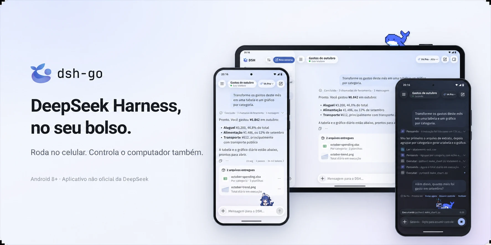
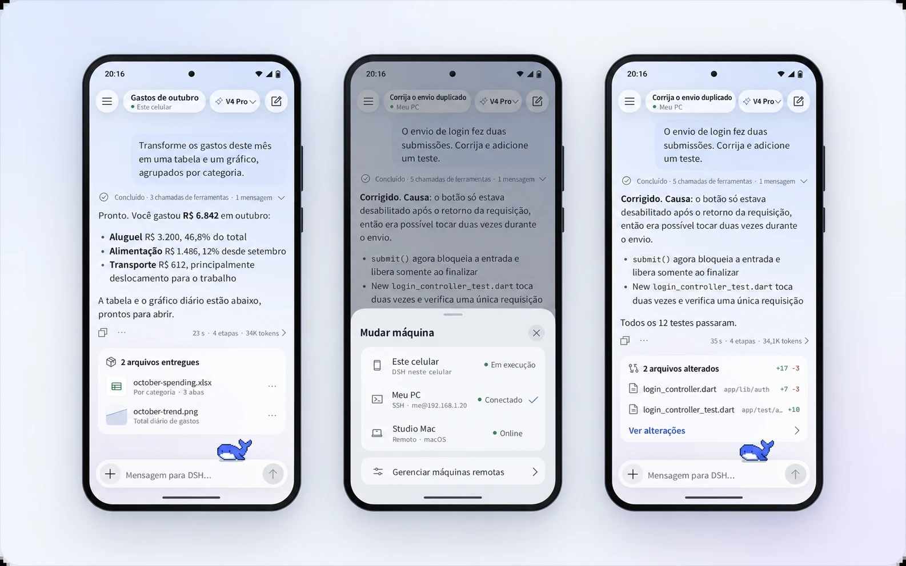
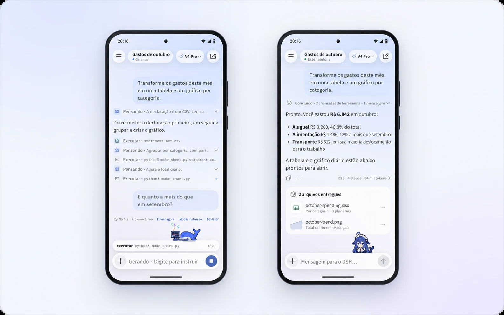
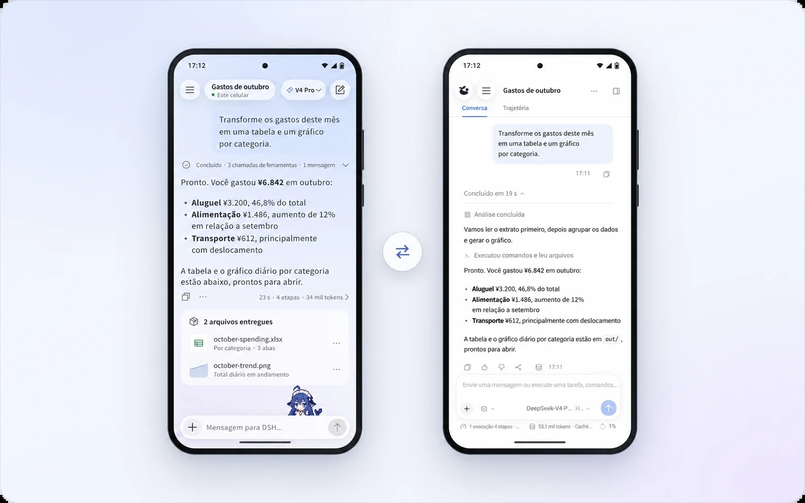
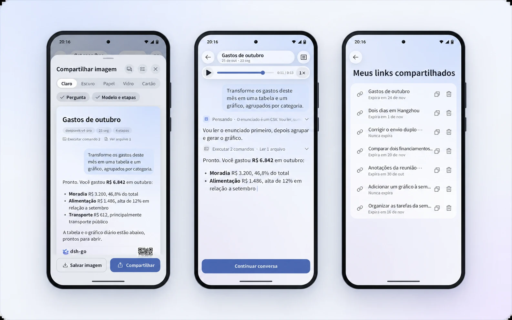
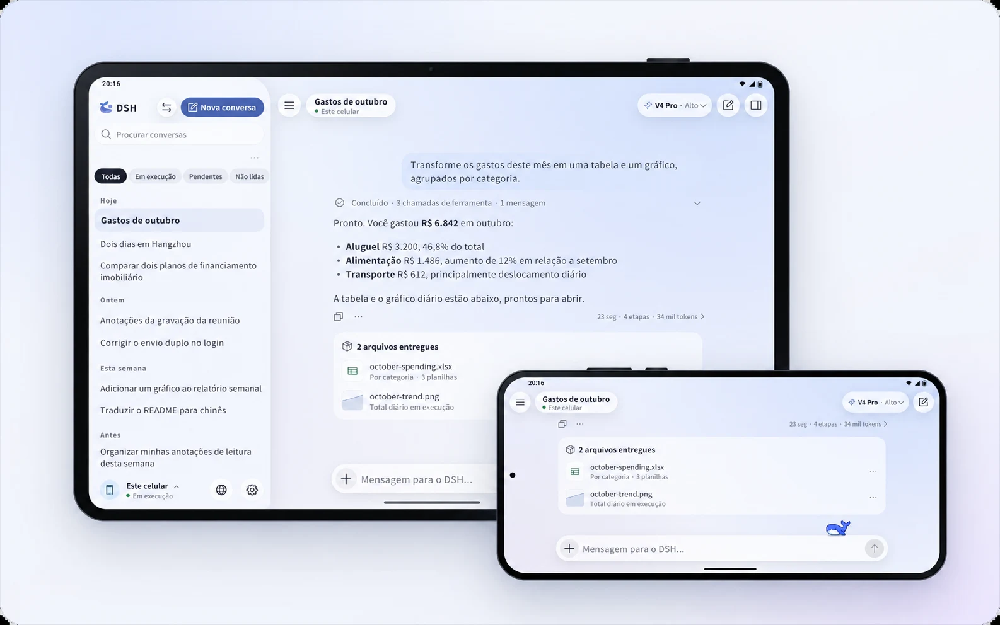
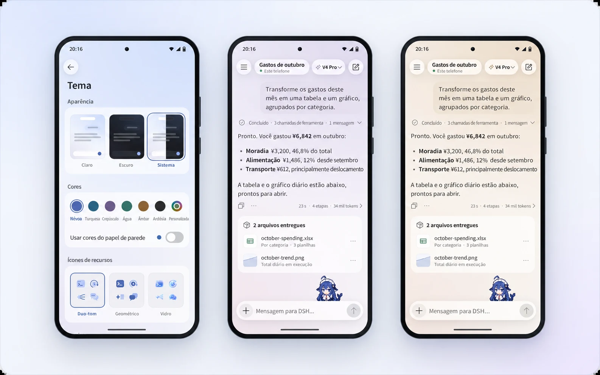
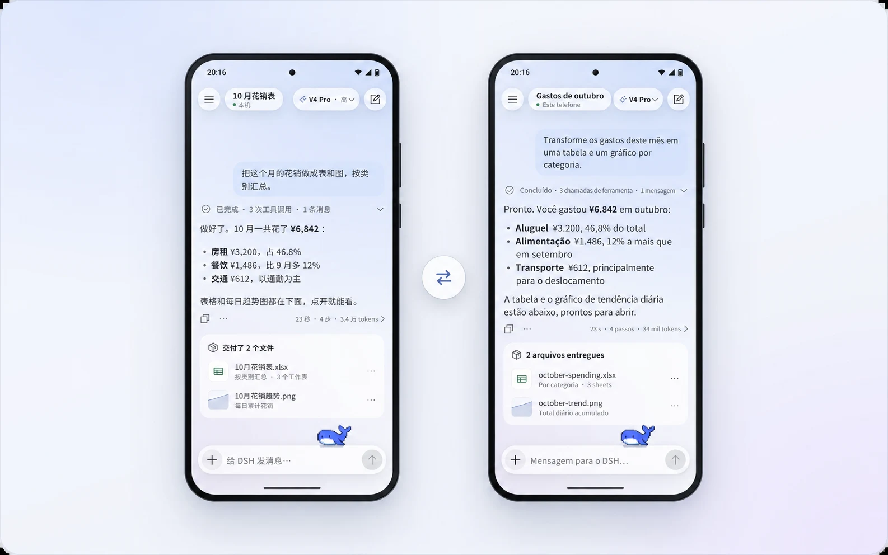
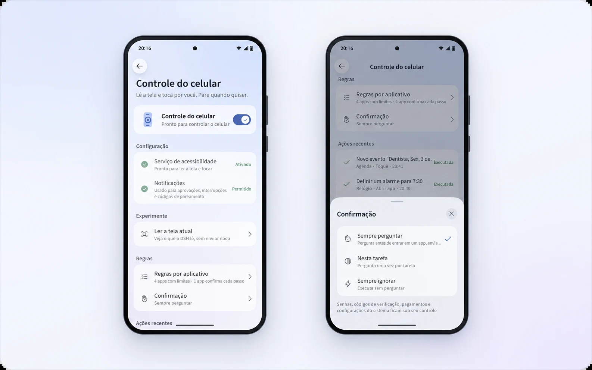

<p align="center">
  <a href="README.md">简体中文</a> · <a href="README.en.md">English</a> · <b>Português</b>
</p>

<p align="center">
  <picture>
    <source media="(prefers-color-scheme: dark)" srcset="docs/assets/hero-pt-BR-dark.webp">
    
  </picture>
</p>

<p align="center">
  Cliente Android para o DeepSeek Harness. Execute o DSH no celular ou controle o DSH do seu computador.
</p>

<p align="center">
  <a href="https://github.com/ccch1mneyyy/dsh-go/releases/latest"></a>
  <a href="LICENSE"></a>
  <a href="https://forum.dshtui.com"></a>
  <a href="https://qm.qq.com/q/OEy2RqZnqY"></a>
</p>

<br>

<h3 align="center">Deepy e a Garota Baleia acompanham você</h3>

<p align="center">Eles programam, comemoram, acenam e descansam enquanto o DSH trabalha. Também podem acompanhar você na tela inicial.</p>

<p align="center">
  <picture><source media="(prefers-color-scheme: dark)" srcset="docs/assets/pet-deepy-typing-en-dark.gif"></picture> <picture><source media="(prefers-color-scheme: dark)" srcset="docs/assets/pet-deepy-happy-en-dark.gif"></picture> <picture><source media="(prefers-color-scheme: dark)" srcset="docs/assets/pet-deepy-notification-en-dark.gif"></picture> <picture><source media="(prefers-color-scheme: dark)" srcset="docs/assets/pet-deepy-sleeping-en-dark.gif"></picture>
</p>

<p align="center">
  <picture><source media="(prefers-color-scheme: dark)" srcset="docs/assets/pet-girl-typing-en-dark.gif"></picture> <picture><source media="(prefers-color-scheme: dark)" srcset="docs/assets/pet-girl-happy-en-dark.gif"></picture> <picture><source media="(prefers-color-scheme: dark)" srcset="docs/assets/pet-girl-notification-en-dark.gif"></picture> <picture><source media="(prefers-color-scheme: dark)" srcset="docs/assets/pet-girl-sleeping-en-dark.gif"></picture>
</p>

<br>

<a id="download"></a>
<h3 align="center">Baixe o DSH Go</h3>

<p align="center">Baixe o APK mais recente pelo GitHub Releases ou pela página de downloads em go.dshtui.com. O pacote arm64 serve para a maioria dos celulares.</p>

<p align="center">
  <a href="https://github.com/ccch1mneyyy/dsh-go/releases/latest"></a>&emsp;<a href="https://go.dshtui.com/download"></a>
</p>

<p align="center">
  <b>Obrigado pelo apoio ao DSH Go! Pretendo adaptar o aplicativo para iOS e HarmonyOS assim que possível. Quanto mais estrelas, mais rápido isso acontece, hehe.</b>
</p>

<p align="center">
  <a href="https://github.com/ccch1mneyyy/dsh-go/stargazers"></a>
</p>

<p align="center">
  <sub>É sua primeira vez? Comece pelo <a href="docs/guide/README.md">guia de uso</a>. Se precisar de ajuda, visite o <a href="#community">fórum ou os grupos da comunidade</a>.</sub><br>
  <sub>Uma versão de testes antiga com assinatura diferente não pode ser atualizada por cima: é preciso desinstalá-la, o que apaga conversas, o ambiente Linux e as configurações.</sub>
</p>

<br>

<h3 align="center">Execute no celular e controle o computador</h3>

<p align="center">Um ambiente Linux integrado, sem root e sem instalar o Termux. Alterne para o DSH do seu computador com um toque.</p>

<p align="center">
  <picture>
    <source media="(prefers-color-scheme: dark)" srcset="docs/assets/f-remote-pt-BR-dark.webp">
    
  </picture>
</p>

<br>

<h3 align="center">Intervenha durante uma resposta</h3>

<p align="center">Envie uma mensagem enquanto o DSH responde e toque em “Enviar agora” quando quiser. As etapas concluídas ficam recolhidas em uma linha.</p>

<p align="center">
  <picture>
    <source media="(prefers-color-scheme: dark)" srcset="docs/assets/f-steer-pt-BR-dark.webp">
    
  </picture>
</p>

<br>

<h3 align="center">Interface nativa e modo web</h3>

<p align="center">Alterne entre o aplicativo nativo e a interface web oficial na mesma conversa. Ao voltar, a última interface usada será aberta novamente.</p>

<p align="center">
  <picture>
    <source media="(prefers-color-scheme: dark)" srcset="docs/assets/f-web-pt-BR-dark.webp">
    
  </picture>
</p>

<br>

<h3 align="center">Cartões, reproduções e links de compartilhamento</h3>

<p align="center">Transforme uma resposta em um cartão. Compartilhe uma conversa inteira por link, com reprodução no navegador e criptografia de ponta a ponta.</p>

<p align="center">
  <picture>
    <source media="(prefers-color-scheme: dark)" srcset="docs/assets/f-share-pt-BR-dark.webp">
    
  </picture>
</p>

<br>

<h3 align="center">Celulares na horizontal e tablets</h3>

<p align="center">O layout se adapta: a barra lateral permanece visível, o conteúdo fica centralizado e o teclado não aperta a interface.</p>

<p align="center">
  <picture>
    <source media="(prefers-color-scheme: dark)" srcset="docs/assets/f-adaptive-pt-BR-dark.webp">
    
  </picture>
</p>

<br>

<h3 align="center">Cores e ícones da tela inicial</h3>

<p align="center">Escolha entre seis cores de destaque, a cor do papel de parede ou uma cor personalizada. Há quatro ícones para a tela inicial e três estilos de ícones de funções.</p>

<p align="center">
  <picture>
    <source media="(prefers-color-scheme: dark)" srcset="docs/assets/f-theme-pt-BR-dark.webp">
    
  </picture>
</p>

<br>

<h3 align="center">简体中文, English e Português</h3>

<p align="center">A interface oferece chinês simplificado, inglês e português do Brasil. Siga o idioma do sistema ou escolha um em Configurações.</p>

<p align="center">
  <picture>
    <source media="(prefers-color-scheme: dark)" srcset="docs/assets/f-lang-pt-BR-dark.webp">
    
  </picture>
</p>

<br>

<h3 align="center">Controle do celular</h3>

<p align="center">O DSH pode ler a tela e tocar por você. Pagamentos, senhas e códigos continuam sob seu controle.</p>

<p align="center">
  <picture>
    <source media="(prefers-color-scheme: dark)" srcset="docs/assets/f-phone-pt-BR-dark.webp">
    
  </picture>
</p>

<br>

## Recursos

O DSH Go reúne uma interface de conversa, um ambiente de execução no celular e conexões remotas. É um projeto de terceiros baseado no [DeepSeek Harness](https://github.com/deepseek-ai/deepseek-harness). O mecanismo DSH roda no celular; as solicitações ao modelo continuam sendo processadas pelo provedor que você configurar.

- **Execução no celular:** instale Ubuntu, Node.js e DSH pelo aplicativo, sem root nem instalação separada do Termux.
- **Conexões remotas:** use o DSH no computador ou no servidor, por SSH ou pelo DSH Remote.
- **Conversas e ferramentas:** alterne modelos, envie imagens, use entrada de voz e responda a pedidos de aprovação ou perguntas. Há interfaces de conversa nativa e web.
- **Interfaces de plugins:** use cartões de ferramentas, formulários e painéis nativos de plugins adaptados ao DSH Go. O repositório inclui SDK, guias e exemplos.
- **Controle do celular:** após conceder as permissões necessárias, permita que o mecanismo local leia a tela, toque e digite. Você pode interrompê-lo a qualquer momento.
- **Compartilhamento e aparência:** compartilhe, exporte e reproduza conversas; personalize temas, ícones e mascotes.

Os recursos disponíveis dependem do host e do tipo de conexão. No momento, o DSH Remote aceita apenas imagens como anexos, não abre a interface web dentro do aplicativo, limita o gerenciamento de plugins a ativar ou desativar e não oferece DS Bot nem exportação de registros de conversas. Veja [Mecanismo local e hosts remotos](docs/guide/en/03-engine-hosts.md) (em inglês).

## Instalação

É necessário Android 8.0 (API 26) ou mais recente. O pacote **arm64** da página de lançamentos serve para a maioria dos celulares Android de 64 bits. O pacote x64 para dispositivos e emuladores x86_64 fica em “Outras versões” no fim das notas de lançamento. Não há compilação para ARM de 32 bits neste repositório.

1. Baixe o APK correspondente à arquitetura do dispositivo em [GitHub Releases](https://github.com/ccch1mneyyy/dsh-go/releases/latest) ou na [página de downloads](https://go.dshtui.com/download) e permita a instalação dessa origem quando o Android solicitar.
2. Na primeira abertura, escolha instalar o ambiente de execução no celular ou conectar um host remoto.
3. Configure o modelo e as credenciais no host escolhido e inicie uma conversa. Alguns provedores remotos exigem configuração diretamente no host.

Se você usar apenas um host remoto, não precisará instalar o ambiente local no celular. O controle do celular funciona com o mecanismo local fora do modo seguro e requer permissões como Acessibilidade, explicadas no aplicativo. O modo sem interrupções também requer Android 14 ou superior e Shizuku ou ADB local. Consulte o [guia de uso](docs/guide/README.md) para a configuração.

Por padrão, o mecanismo local usa a inicialização compatível com PRoot. A inicialização direta fica desativada nas opções de desenvolvedor; consulte as [perguntas frequentes](docs/guide/en/11-faq.md) (em inglês) para conhecer a compatibilidade e a opção de retorno. A compilação Android atual é destinada à instalação manual do APK, não à distribuição pelo Google Play.

## Dados e permissões

As solicitações ao modelo são enviadas ao provedor que você configurar. Durante tarefas de controle do celular, o texto relevante da tela pode ser enviado ao modelo; modelos capazes de analisar imagens também podem receber capturas de tela. Leia a explicação das permissões no aplicativo antes de ativar esse recurso.

“Enviar estatísticas anônimas de uso” vem ativado por padrão. Você pode desativar a opção na primeira configuração ou em Configurações → Privacidade e compartilhamento. Consulte as [perguntas frequentes](docs/guide/en/11-faq.md) (em inglês) para saber quais dados são coletados e o que acontece após a desativação. Confira o conteúdo antes de compartilhá-lo: quem recebe um link ou arquivo pode salvar uma cópia.

## Perguntas frequentes

<details>
<summary><b>Este é um aplicativo oficial da DeepSeek?</b></summary>
<br>

Não. O DSH Go é um cliente não oficial desenvolvido pela comunidade com base no [DeepSeek Harness](https://github.com/deepseek-ai/deepseek-harness), que é de código aberto. O DSH roda no celular; as solicitações ao modelo vão para o provedor que você configurar, exigem conexão e são cobradas conforme a sua conta nesse provedor.

</details>

<details>
<summary><b>É seguro?</b></summary>
<br>

A interface web local só atende ao próprio aplicativo. Os links compartilhados usam criptografia de ponta a ponta: a chave está apenas no link, e o servidor não vê o conteúdo. Por padrão, o controle do celular devolve a você ações de pagamento, senhas, códigos e configurações do sistema.

</details>

<details>
<summary><b>O sistema pode encerrar o aplicativo em segundo plano?</b></summary>
<br>

Alguns sistemas restringem aplicativos para economizar bateria. Quando isso acontece, o DSH Go avisa e abre a configuração apropriada em aparelhos vivo, Xiaomi, Huawei, Honor e OPPO.

</details>

<details>
<summary><b>Qual celular é necessário?</b></summary>
<br>

Android 8 ou superior. No celular, baixe o pacote da página de lançamentos; a versão x86_64 para emuladores fica em “Outras versões” no fim das notas. Para executar o DSH no celular, reserve cerca de 1 GB para o ambiente integrado. Para conectar ao DSH no computador ou servidor, não é necessário instalá-lo.

</details>

<details>
<summary><b>O projeto é de código aberto?</b></summary>
<br>

Sim. O código deste repositório usa a licença [AGPL-3.0](LICENSE); `sdk/` e `examples/` usam MIT. Nome, logotipo e mascotes Deepy e Garota Baleia têm termos próprios; veja [ASSETS.md](ASSETS.md).

</details>

## Compilação a partir do código-fonte

O procedimento a seguir é destinado a **Linux x86_64**. O script da cadeia de ferramentas instala, por padrão, JDK 17, Flutter 3.47.7 e Android SDK/NDK. O aplicativo requer Dart `^3.13.5`. Prepare Bash, Git, curl, tar, unzip, xz, Python 3, zstd (para extrair pacotes deb compactados com zstd quando o Python não oferece `compression.zstd`), `file` e utilitários GNU comuns. A atualização dos arquivos de versões dos pacotes Ubuntu também exige `gpgv`.

Use a árvore completa do código-fonte e dos recursos do projeto. Fontes, imagens e outros arquivos declarados em `app/pubspec.yaml` são necessários para a compilação. O script abaixo gera o pacote do ambiente de execução.

```bash
git clone https://github.com/ccch1mneyyy/dsh-go.git
cd dsh-go

bash tooling/setup-toolchain.sh
source tooling/env.sh
flutter --version
java -version

bash runtime/build-runtime.sh arm64-v8a
DSH_BETA_TOKEN_FILE= bash tooling/build-apk.sh -f arm64 --keep-daemon
```

O script da cadeia de ferramentas baixa SDK/NDK e imagens para emulador e aceita as licenças do Android SDK. O local padrão é `~/dev`; use `DEV_ROOT` para escolher outra pasta. O script reutiliza instalações existentes; confira as versões antes de compilar.

O APK resultante fica em `app/build/app/outputs/flutter-apk/app-arm64-release.apk`. A montagem do ambiente de execução usa versões e verificações fixadas no repositório e precisa de acesso à internet para baixar dependências. `DSH_BETA_TOKEN_FILE=` impede a inclusão do token de acesso ao canal beta dos mantenedores. `--keep-daemon` mantém o Gradle em execução, útil ao desenvolver outros projetos Android.

Para compilar o APK x86_64, gere primeiro o ambiente correspondente:

```bash
bash runtime/build-runtime.sh x86_64
DSH_BETA_TOKEN_FILE= bash tooling/build-apk.sh -f x64 --keep-daemon
```

Sem `app/android/key.properties`, a versão de lançamento local usa a assinatura de depuração. Ela não pode substituir uma instalação oficial com assinatura diferente. Instale em um dispositivo de testes e preserve os dados existentes; não desinstale o aplicativo de uso diário apenas para resolver um conflito de assinatura. Não inclua chaves de assinatura nem sua configuração no repositório.

Para consultar os comandos de compilação sem gerar um APK:

```bash
DSH_BETA_TOKEN_FILE= bash tooling/build-apk.sh --dry-run -f all
```

## Estrutura do repositório

| Caminho | Conteúdo |
| --- | --- |
| `app/` | Interface Flutter e código nativo Android em Kotlin |
| `packages/dsh_client/` | Cliente Dart para a API web do DSH |
| `packages/dsh_remote/` | Cliente Dart para o DSH Remote |
| `runtime/` | Montagem do ambiente Linux, modificações do mecanismo e ponte com o aplicativo |
| `sdk/plugin-kit/` | Ferramentas para autores de plugins nativos, usadas no repositório e não publicadas no npm |
| `examples/plugins/` | Exemplos de plugins |
| `docs/guide/`, `docs/plugins/` | Guias de uso e de desenvolvimento de plugins |
| `docs/assets/` | Imagens, animações dos mascotes e códigos QR desta página |
| `tooling/` | Scripts da cadeia de ferramentas, compilação de APK e diagnósticos |
| `services/`, `site/`, `infra/` | Serviço de compartilhamento, site e materiais de implantação |

## Contribuições

Relate problemas e sugira melhorias em [Issues](https://github.com/ccch1mneyyy/dsh-go/issues). Para colaborar com código, documentação ou tradução, comece por [CONTRIBUTING.md](CONTRIBUTING.md). Autores de plugins podem consultar os [guias de plugins](docs/plugins/en/README.md) e o [SDK](sdk/plugin-kit/README.en.md), disponíveis em inglês.

Relate problemas de segurança pelo procedimento de [SECURITY.md](SECURITY.md). Não publique detalhes de vulnerabilidades ou credenciais em issues abertas.

<a id="community"></a>

## Comunidade

- **Fórum:** [forum.dshtui.com](https://forum.dshtui.com)
- **Grupo QQ:** `1132118290` ([entrar](https://qm.qq.com/q/OEy2RqZnqY))
- **Grupo WeChat:** use o código QR abaixo; se estiver vencido, entre pelo grupo QQ
<!-- Telegram: adicionar o link quando estiver disponível -->

<p align="center">
  <a href="https://qm.qq.com/q/OEy2RqZnqY"><picture><source media="(prefers-color-scheme: dark)" srcset="docs/assets/qr-qq-en-dark.webp"></picture></a>&emsp;&emsp;<picture><source media="(prefers-color-scheme: dark)" srcset="docs/assets/qr-wechat-en-dark.webp"></picture>
</p>

<p align="center">
  <sub>Grupo QQ <code>1132118290</code>. No computador, <a href="https://qm.qq.com/q/OEy2RqZnqY">entre com um clique</a>. O código QR do WeChat muda toda semana; se estiver vencido, entre no grupo QQ.</sub>
</p>

## Licença e agradecimentos

Este projeto usa a licença [AGPL-3.0](LICENSE). `sdk/` e `examples/` permanecem sob **MIT**. Código e recursos de terceiros conservam os termos indicados em suas respectivas declarações.

- [DeepSeek Harness](https://github.com/deepseek-ai/deepseek-harness): mecanismo que o DSH Go executa e ao qual se conecta.
- [DSH-TUI](https://github.com/ccch1mneyyy/dsh-TUI): origem dos mascotes Deepy e Garota Baleia.

Código derivado de Phase é usado com permissão do autor. DeepSeek Harness, PiPilot, DS Bot, DSH Remote e outros componentes e recursos de terceiros mantêm suas licenças e atribuições. Consulte [THIRD_PARTY_NOTICES.md](THIRD_PARTY_NOTICES.md) para as fontes e condições.

O nome e o logotipo DSH Go e os mascotes Deepy e Garota Baleia não estão cobertos pela AGPL; consulte [ASSETS.md](ASSETS.md) para os termos de uso.

<sub>As conexões remotas usam como referência o projeto e o servidor [ds-harness-remote](https://github.com/liguobao/ds-harness-remote). Agradecimentos ao autor, liguobao.</sub>

<br>

<p align="center"><sub>DSH Go é um cliente não oficial criado pela comunidade. Não é afiliado à DeepSeek nem tem seu endosso. Os nomes e marcas da DeepSeek pertencem aos respectivos titulares.</sub></p>
